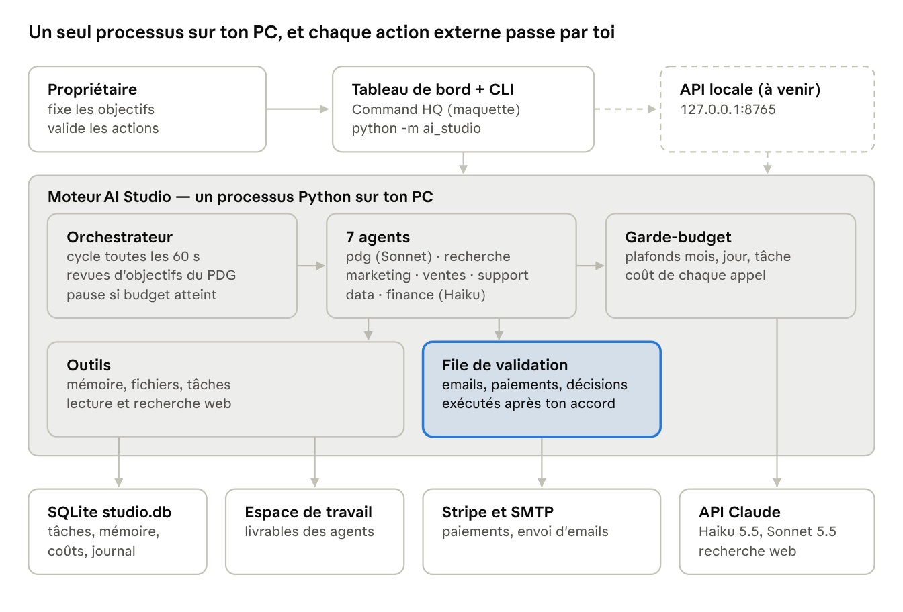
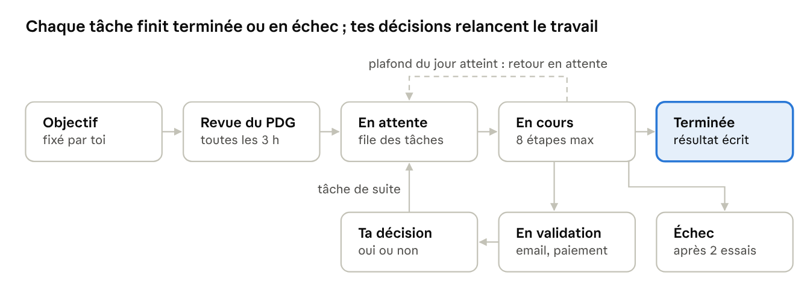
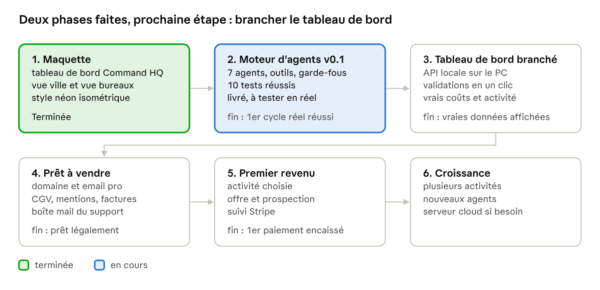

# AI Enterprise Studio — Documentation de conception

_Version du 27/11/2026. Version en ligne (modifiable et commentable) : https://claude.ai/artifact/5HJkzTKdme1Dr48Cui2UPh_

## Sommaire

1. [Vision et objectifs](#1-vision-et-objectifs)
2. [Contexte et contraintes](#2-contexte-et-contraintes)
3. [Principes de conception](#3-principes-de-conception)
4. [Architecture générale](#4-architecture-générale)
5. [L'équipe d'agents](#5-léquipe-dagents)
6. [Catalogue des outils](#6-catalogue-des-outils)
7. [Orchestration](#7-orchestration)
8. [Garde-fous](#8-garde-fous)
9. [Modèle de données](#9-modèle-de-données)
10. [Interface : tableau de bord et API locale](#10-interface--tableau-de-bord-et-api-locale)
11. [Installation et exploitation](#11-installation-et-exploitation)
12. [Tests et qualité](#12-tests-et-qualité)
13. [Feuille de route](#13-feuille-de-route)
14. [Décisions et questions ouvertes](#14-décisions-et-questions-ouvertes)
15. [Glossaire](#15-glossaire)

## 1. Vision et objectifs

AI Enterprise Studio est une entreprise réelle, opérée par une équipe d'agents IA, qui doit générer des revenus avec un minimum d'intervention de son propriétaire.

**Objectifs**

1. Encaisser un premier revenu réel via Stripe, puis un revenu récurrent.
2. Faire tourner l'entreprise 24 h/24 : le propriétaire fixe des objectifs, les agents planifient, exécutent et rendent compte.
3. Rester rentable dès le départ : les dépenses (API, hébergement) sont plafonnées et mesurées en continu.
4. Pouvoir lancer plusieurs activités, dans plusieurs pays, sans se limiter à un secteur.
5. Améliorer le système en continu : les agents mesurent ce qui marche et proposent des améliorations.

**Ce que le produit n'est pas**

- Une simulation ou un jeu : le tableau de bord est gamifié, mais chaque chiffre affiché doit être réel.
- Un système sans contrôle : tout engagement externe (email, paiement, publication, contrat) attend la validation du propriétaire.
- Un générateur de spam ou de contenus trompeurs : la conformité légale est une règle permanente des agents.

## 2. Contexte et contraintes

Le système démarre petit : une micro-entreprise française, 20 $ d'API par mois et un PC personnel allumé en permanence.

| Élément | Situation actuelle | Conséquence pour la conception |
| --- | --- | --- |
| Structure juridique | Micro-entreprise française enregistrée | Activités compatibles avec l'activité déclarée ; franchise de TVA à vérifier selon le chiffre d'affaires |
| Paiements | Compte Stripe existant | Encaissement par liens de paiement Stripe, créés après validation |
| Code | Compte GitHub existant | Dépôt privé, secrets jamais versionnés |
| Nom de domaine | Aucun | À acheter avant toute prospection par email (délivrabilité, crédibilité) |
| Budget API | 20 $ par mois pour la phase de test | Modèle économique par défaut, plafonds stricts par jour et par tâche |
| Hébergement | PC du propriétaire, 24 h/24 | Aucune dépendance serveur ; reprise automatique après redémarrage ; pas de service client critique hébergé sur le PC |
| Activité | Pas encore choisie (piste : services numériques) | Moteur générique ; l'activité est un objectif donné au PDG |
| Temps du propriétaire | À minimiser | Interventions limitées aux validations et aux décisions, en un clic |

Certaines actions restent forcément humaines : création de comptes, engagements légaux, vérifications d'identité des plateformes.

## 3. Principes de conception

Neuf principes guident chaque choix technique ; en cas de conflit, la sécurité et le budget passent avant la vitesse.

1. **Réel avant tout** : aucun chiffre inventé, ni par les agents ni dans le tableau de bord.
2. **Humain dans la boucle pour l'externe** : tout ce qui sort de l'entreprise passe par une validation.
3. **Budget piloté** : chaque appel est chiffré avant et après ; au-delà d'un plafond, le moteur s'arrête seul.
4. **Simplicité** : Python standard, SQLite, zéro dépendance tant que possible ; un seul processus.
5. **Modularité** : ajouter un agent ou un outil = une déclaration, sans toucher au moteur.
6. **Traçabilité** : chaque action, décision et dépense est journalisée et consultable.
7. **Robustesse** : un arrêt brutal ne perd rien ; les tâches interrompues reprennent.
8. **Continuité** : on améliore l'existant au lieu de le réécrire ; les données sont préservées entre versions.
9. **Testé** : chaque fonctionnalité du moteur est couverte par des tests qui ne coûtent rien (faux modèle).

## 4. Architecture générale

Tout tourne dans un seul processus Python sur le PC : l'orchestrateur réveille les agents, chaque appel à l'API passe par le garde-budget, et chaque action externe passe par la file de validation.

En pointillés, l'API locale qui reliera le tableau de bord au moteur à la phase 3. Les composants correspondent aux fichiers du projet : `orchestrator.py`, `agents.py`, `runner.py`, `llm.py`, `tools/`, `approvals.py` et `db.py`.

## 5. L'équipe d'agents

Sept agents, un par pôle du tableau de bord : le PDG délègue, les six spécialistes exécutent. Seul le PDG utilise le modèle fort, pour contenir les coûts.

**Deux fournisseurs possibles** : Anthropic ou OpenAI, au choix dans `config.json` (`provider`). En mode `auto`, le moteur prend Anthropic si `ANTHROPIC_API_KEY` est présente, sinon OpenAI. Le moteur parle en interne le format d'Anthropic ; le client OpenAI traduit les messages et les appels d'outils vers l'API Chat Completions.

| Niveau | Anthropic | OpenAI | Prix OpenAI (entrée / sortie, par million de tokens) |
| --- | --- | --- | --- |
| Économique (6 agents) | Claude Haiku 5.5 | gpt-6-luna | 0,10 $ / 0,50 $ |
| Fort (PDG) | Claude Sonnet 5.5 | gpt-6.1-terra | 1 $ / 5 $ |

La phase de test utilise OpenAI (crédits déjà disponibles chez le propriétaire).

| Agent | Pôle | Modèle | Responsabilités | Ne fait jamais |
| --- | --- | --- | --- | --- |
| pdg | Command HQ | Fort | Traduit les objectifs en missions, délègue, suit l'avancement, arbitre budgets et priorités, clôture les objectifs | Le travail des spécialistes |
| recherche | Labo Recherche | Économique | Marchés, besoins, concurrence, prix, niches ; cite ses sources | Présenter une estimation comme un fait |
| marketing | Hub Marketing | Économique | Positionnement, offres, messages, contenus multilingues | Promesses exagérées |
| ventes | Centre Ventes | Économique | Prospects B2B, messages personnalisés, offres, liens de paiement | Envoyer un email ou créer un paiement sans validation |
| support | Zone Support | Économique | Réponses clients, FAQ, procédures, problèmes récurrents | Répondre à un client sans validation |
| data | Data Core | Économique | Entretien de la mémoire, mesures, propositions d'amélioration | Modifier les règles des autres agents |
| finance | Trésorerie | Économique | Revenus Stripe, coûts API, rentabilité, alertes de dérive, prix | Effectuer un paiement |

**Comment un agent est défini** : un nom, un pôle, une mission rédigée, une liste d'outils autorisés, un niveau de modèle (économique ou fort) et l'accès ou non à la recherche web. Le prompt système assemble l'identité de l'entreprise, la mission, la liste de l'équipe et les règles permanentes.

**Règles permanentes communes** : pas de chiffres inventés, estimation de l'effort en coût d'API et en temps de validation du propriétaire (pas en heures humaines), concision (chaque appel coûte), respect du droit français et européen (RGPD, consommation, propriété intellectuelle), validation pour tout engagement externe, livrables écrits dans des fichiers, vérification de la mémoire avant de commencer, fin systématique par un résultat clair.

**Agents envisagés plus tard** : juridique (conformité, CGV), production (exécution des services vendus), contrôle qualité (relecture avant validation).

**Juridique (ajouté le 27/11/2026)** : agent de conformité (CGV, mentions, RGPD, factures). Il relit automatiquement les pages et liens de paiement avant la décision du propriétaire ; son avis s'affiche sur la validation sans la bloquer.

**Atelier (ajouté le 27/11/2026)** : agent de production des livrables clients (modèle fort, 16 étapes, 0,40 $ par tâche au maximum). Il fabrique ce qui est vendu selon la fiche d'offre, puis passe la main au support pour la livraison. Les autres pôles gardent leurs fonctions internes (veille, communication, ventes…).

## 6. Catalogue des outils

Chaque agent n'accède qu'aux outils de son rôle ; les outils marqués « validation » créent une demande au lieu d'agir. Un outil qui dépend d'une clé absente du `.env` (Stripe, Brave) n'est pas proposé aux agents, pour éviter des appels inutiles.

| Outil | Fonction | Accès | Validation | Coût |
| --- | --- | --- | --- | --- |
| complete_task | Termine la tâche avec un résultat | Tous | Non | — |
| remember / recall | Écrit et cherche dans la mémoire partagée | Tous | Non | — |
| list_tasks / get_task_result | Consulte les tâches et leurs résultats | Tous | Non | — |
| write_file / read_file / list_files | Livrables dans l'espace de travail (bac à sable) ; `append=true` pour écrire un long document en plusieurs parties | Tous | Non | — |
| request_owner_decision | Pose une question au propriétaire | Tous | Réponse attendue | — |
| list_objectives | Lit les objectifs de l'entreprise | Tous | Non | — |
| delegate_task | Crée une tâche pour un autre agent | Tous (profondeur max. 3) | Non | — |
| set_objective_status | Clôture ou met en pause un objectif | pdg | Non | — |
| brave_search (principal) / web_search Anthropic (secours, fournisseur Anthropic uniquement) | Recherche web avec sources | recherche, marketing, ventes | Non | Brave 0,005 $ par requête (crédits offerts) ; Anthropic 0,01 $ ; 30 par jour au total |
| fetch_url | Lit le texte d'une page publique | recherche, marketing, ventes | Non | Tokens uniquement |
| send_email | Prépare un email, envoyé en SMTP après accord | ventes, support | Oui | — |
| propose_payment_link | Propose un lien de paiement Stripe | ventes, finance | Oui | — |
| stripe_balance / stripe_recent_payments | Lit le solde et les paiements | finance | Non | — |
| budget_status / company_stats | Dépenses et statistiques internes | pdg, data, finance | Non | — |
| send_email (in_reply_to, attachment) | Réponse dans le fil d'un email reçu, pièce jointe de l'espace de travail (10 Mo max.) | ventes, support | Oui | — |
| list_inbox / read_email | Emails reçus ; contenu délimité comme donnée externe | ventes, support (pdg : liste) | Non | — |
| list_sales | Ventes encaissées et chiffre du mois (sans appel Stripe) | pdg, marketing, ventes, support, finance | Non | — |
| save_offer / list_offers | Catalogue d'offres : prix, livrable, délai, infos client, agent producteur | pdg, marketing, ventes, finance (lecture : tous les producteurs) | Non | — |
| list_orders / set_order_status | Commandes payées, état de livraison, fichiers liés | pdg, support, producteurs | Non | — |
| deliver_order | Email de livraison avec le livrable ; la validation marque la commande livrée | support | Oui | — |
| propose_page | Publication d'une page HTML sur GitHub Pages (pied de page légal ajouté, ni script ni formulaire) | marketing, ventes | Oui (aperçu) | — |

**Boucle commerciale automatique (sans coût d'API)** : à chaque cycle, le moteur lit les sessions de paiement Stripe (toutes les 10 min) et la boîte Gmail en IMAP lecture seule (toutes les 5 min). Une vente payée crée une tâche de livraison prioritaire pour le PDG et une notification ; un email reçu (hors newsletters, envois automatiques et nos propres messages) crée une tâche de réponse pour l'agent ventes (si on lui avait écrit) ou support, dans la limite de 10 par jour. Au premier passage, l'historique Stripe de 30 jours est importé sans tâche, et l'historique de la boîte n'est pas traité.

**Outils prévus** : publication sur les réseaux, génération de documents (devis, factures conformes), recherche d'entreprises via des sources publiques (annuaire des entreprises de l'État), appel de workflows n8n (`run_workflow`).

### Recherche web : Brave Search API en priorité

Brave devient le moteur de recherche principal des agents : il coûte deux fois moins cher par requête et ses crédits mensuels gratuits couvrent notre volume de test. La recherche web d'Anthropic reste en secours, uniquement quand le fournisseur est Anthropic et que `BRAVE_API_KEY` est absente ; avec OpenAI sans clé Brave, les agents n'ont que `fetch_url`.

| Critère | Brave Search API | Recherche web Anthropic |
| --- | --- | --- |
| Prix | 5 $ pour 1 000 requêtes, avec 5 $ de crédits offerts chaque mois ([Brave](https://brave.com/search/api)) | 10 $ pour 1 000 recherches |
| Coût en tokens | Nous choisissons le nombre de résultats et la longueur des extraits envoyés au modèle | Les résultats sont facturés en tokens d'entrée, dans le tour et les suivants |
| Volume prévu (30 par jour, environ 900 par mois) | Environ 4,50 $, couverts par les 5 $ de crédits offerts | Environ 9 $ plus les tokens |
| Intégration | Outil local `brave_search` : appel HTTP, clé `BRAVE_API_KEY` dans `.env` | Outil serveur, aucune clé supplémentaire |
| Rôle prévu | Principal | Secours si Brave est indisponible ou sans clé |

Une carte bancaire est demandée à l'inscription chez Brave ; le plafond `web_searches_per_day` s'applique aux deux moteurs.

### n8n : couche d'intégrations, pas cerveau des agents

n8n sert à brancher les applications externes ; la planification et les décisions restent dans le moteur Python, pour garder un seul endroit où s'appliquent budget, validations et journal.

- **Ce que n8n apporte** : plus de 400 connecteurs (messagerie, réseaux sociaux, tableurs, CRM), des déclencheurs (webhook Stripe, nouvel email) et une édition auto-hébergée gratuite, sans limite d'exécutions, sous licence Sustainable Use (usage interne à l'entreprise autorisé).
- **Ce qu'il coûte** : Node.js ou Docker à installer et maintenir sur le PC, et une seconde application à surveiller.
- **Comment les deux se parlent** :
    1. Les agents appellent un workflow n8n via un outil `run_workflow` (webhook local). Un workflow qui agit vers l'extérieur passe par la file de validation.
    2. n8n envoie des événements au moteur via l'API locale : paiement reçu, email entrant, formulaire rempli. Chaque événement devient une tâche pour l'agent concerné.
- **Quand l'ajouter** : phase 4 (« Prêt à vendre »), quand les premières intégrations deviennent nécessaires (boîte mail, publication de contenus, webhooks Stripe). Avant, le moteur seul suffit.

## 7. Orchestration

Le propriétaire donne des objectifs, le PDG les transforme en tâches, et le moteur exécute jusqu'à 3 tâches par cycle de 60 secondes, par ordre de priorité.

**Déroulement d'un cycle**

1. Contrôle du budget du jour et du mois : s'il est atteint, le moteur se met en pause.
2. Revue des objectifs actifs : une tâche « Revue de l'objectif » est créée pour le PDG si la dernière date de plus de 3 h et qu'aucune n'est en cours.
3. Exécution : la tâche la plus prioritaire est confiée à son agent, puis la suivante, jusqu'à 3 tâches.

**Déroulement d'une tâche** : l'agent reçoit un briefing (titre, description, tâche parente, objectif, souvenirs utiles), puis alterne réflexion et appels d'outils jusqu'à `complete_task`, dans la limite de 8 étapes. À chaque étape, tout l'historique est renvoyé au modèle : les résultats d'outils anciens (pages lues, résultats de recherche) sont donc raccourcis, seuls les 2 derniers restent entiers. Lors du premier test réel, l'agent Recherche avait lu 428 000 tokens pour en écrire 18 000. Une erreur d'API est retentée une fois. Au redémarrage, les tâches restées « en cours » repassent en attente.

## 8. Garde-fous

Quatre familles de protections encadrent les agents : budget, validations, sécurité technique et conformité légale.

**Budget** (valeurs par défaut, modifiables dans `config.json`)

| Plafond | Valeur | Effet quand il est atteint |
| --- | --- | --- |
| Mensuel | 20 $ | Moteur en pause jusqu'au mois suivant |
| Journalier | 0,65 $ | Moteur en pause jusqu'au lendemain |
| Par tâche | 0,15 $ | Tâche close avec un résultat partiel |
| Recherches web | 30 par jour | Outil retiré aux agents pour la journée |
| Étapes par tâche | 8 | L'agent est sommé de conclure |
| Tâches ouvertes | 30 | Toute nouvelle délégation est refusée |

Le coût est calculé à partir des tokens réellement facturés par l'API, cache et recherches web compris. Une limite de dépense est aussi fixée dans la console du fournisseur (OpenAI ou Anthropic), en double sécurité.

**Validations du propriétaire** : emails, liens de paiement et décisions passent par une file d'attente. Après décision, l'action validée est exécutée et l'agent demandeur reçoit une tâche de suite.

**Sécurité technique**

- Secrets uniquement dans `.env` (clés API, Stripe, SMTP), jamais dans le code ni sur GitHub.
- Clé Stripe restreinte : lecture du solde et des paiements, création de prix et de liens de paiement, rien d'autre.
- Fichiers des agents confinés à `data/workspace/` ; la lecture web refuse les adresses privées et locales.
- Un outil en erreur renvoie un message à l'agent sans arrêter le moteur.
- Le contenu web lu par les agents est traité comme une donnée, jamais comme une instruction (risque d'injection).

**Conformité légale**

- Prospection uniquement B2B, liée à l'activité du destinataire, avec un moyen simple de refuser les messages suivants (RGPD, recommandations CNIL).
- Limite de 20 brouillons d'emails par jour.
- Pas de faux avis, pas d'usurpation, respect de la propriété intellectuelle.
- Mentions légales, CGV et factures conformes au statut de micro-entrepreneur avant la première vente.

## 9. Modèle de données

Toutes les données tiennent dans un seul fichier SQLite, `data/studio.db`, en mode WAL pour supporter le moteur et la ligne de commande en même temps.

| Table | Contenu | Champs clés |
| --- | --- | --- |
| objectives | Objectifs fixés par le propriétaire | text, status (active, done, paused), last_review_at |
| tasks | Missions confiées aux agents | title, description, agent, status, priority (1 à 5), parent_id, objective_id, created_by, depth, attempts, result, cost_usd |
| memory | Mémoire partagée de l'entreprise | agent, topic, content, shared |
| costs | Chaque appel API facturé | day, month, agent, task_id, model, input_tokens, output_tokens, web_searches, usd |
| approvals | File de validation du propriétaire | agent, task_id, action, payload (JSON), reason, status, result |
| events | Journal de toutes les actions | ts, agent, kind, message, task_id |

**États d'une tâche** : pending, running, done, failed, blocked. **États d'une validation** : pending, approved, rejected, executed, error.

| sales | Paiements Stripe encaissés | id (session Stripe), amount, currency, customer_email, product, livemode, task_id (livraison) |
| offers | Catalogue d'offres | name, price_eur, deliverable, delay_hours, required_info, producer, payment_link_id |
| inbox | Emails reçus | uid, message_id, from_addr, subject, body, status (new, queued, ignored, replied), reason, task_id |

**Évolutions prévues** : rapprochement des ventes par activité, table des contacts (prospects et clients, avec base légale et date de consentement ou d'opposition), table des activités (offres, prix, rentabilité). Chaque évolution passera par une migration qui conserve les données existantes.

## 10. Interface : tableau de bord et API locale

Le tableau de bord Command HQ, déjà maquetté, sera branché sur le moteur via une petite API locale ; la ligne de commande reste disponible.

**Maquette existante** : [Command HQ](https://claude.ai/artifact/CvRpS2tPDf75zQ9GG3chXB) — menu latéral (niveau du HQ, XP, progression globale), tuiles d'indicateurs, carte isométrique avec vue ville et vue bureaux, fiche du pôle, fil d'activité, succès, cartes d'agents, file de tâches, pipeline de revenus.

**Correspondance des écrans avec les données**

| Élément du tableau de bord | Source réelle |
| --- | --- |
| Tuiles Agents actifs, Tâches en cours, Tâches terminées | tasks |
| Tuile Budget API, Trésorerie | costs + plafonds de config.json |
| Tuile Revenus du mois, pipeline de revenus | Stripe (via l'agent finance) |
| Fil d'activité | events |
| Cartes d'agents et statuts | tâche en cours de chaque agent |
| Fiche du pôle | tâches et mémoire de l'agent du pôle |
| Succès, niveau du HQ, XP | calculés à partir des tâches terminées et des revenus |
| Bouton Valider / Refuser | approvals |

**API locale (en place depuis la phase 3)** : un serveur HTTP Python standard sur `http://127.0.0.1:8765` (`ai_studio/server.py`), qui sert aussi la page du tableau de bord (`ai_studio/web/index.html`). Lancement : `python -m ai_studio serveur`, ou `run --tableau` pour le moteur et le tableau de bord ensemble.

Sécurité : écoute sur 127.0.0.1 uniquement ; en-tête Host limité à 127.0.0.1 ou localhost (contre le DNS rebinding) ; toute requête POST exige l'en-tête `X-AI-Studio: 1`, qu'un autre site ne peut pas envoyer (contre les requêtes forgées) ; en-têtes CSP et anti-iframe ; textes des agents affichés sans jamais être interprétés comme du HTML ; fichiers limités à l'espace de travail.

| Méthode et chemin | Rôle |
| --- | --- |
| GET / | Page du tableau de bord |
| GET /api/status | Indicateurs, budget, état du moteur (dernier cycle), niveau, XP, succès, objectif en cours |
| GET /api/agents | Agents, statut, tâche en cours |
| GET /api/tasks?status=&agent= | Liste des tâches |
| GET /api/tasks/{id} | Détail : consigne, résultat, journal, tâches créées |
| POST /api/tasks/{id}/retry | Relancer une tâche en échec ou bloquée |
| GET /api/events?since= | Fil d'activité |
| GET /api/approvals | Validations en attente |
| POST /api/approvals/{id} | Valider ou refuser, avec une note |
| GET /api/insights?days=7 | Séries réelles du panneau Performance, pipeline commercial, prochaines échéances |
| GET, POST /api/map | Vue (ville ou bureaux) et bâtiment choisi par pôle, mémorisés |
| GET /api/integrations | État des connexions (IA, Brave, Stripe, SMTP) |
| GET /api/objectives | Objectifs et avancement |
| POST /api/objectives | Ajouter un objectif |
| POST /api/objectives/{id} | Mettre en pause, réactiver, marquer atteint |
| GET /api/costs | Dépenses par jour et par agent |
| GET /api/files, GET /api/file?path= | Livrables de l'espace de travail |

**Ligne de commande** : `python -m ai_studio` avec init, objectif, tache, run, status, validations, valider, refuser, taches, voir, journal, couts, agents.

## 11. Installation et exploitation

L'installation prend une dizaine de minutes sur Windows et ne demande que Python 3.10 ou plus récent.

**Installation**

1. Installer Python depuis python.org en cochant « Add Python to PATH ».
2. Cloner le dépôt : `git clone https://github.com/Ax-07/Claude-AI-Entreprise.git`.
3. Lancer `python -m ai_studio init` : création de `config.json` et `.env`.
4. Coller une clé de fournisseur (`OPENAI_API_KEY` ou `ANTHROPIC_API_KEY`) et `BRAVE_API_KEY` dans `.env` ; ajouter la clé Stripe restreinte et le SMTP quand ils sont prêts.
5. Fixer une limite de dépense mensuelle dans la console du fournisseur.
6. Tester avec `python -m ai_studio run --once`, puis lancer `demarrer.bat` pour le fonctionnement continu.

**Exploitation au quotidien (objectif : moins de 10 minutes par jour)**

- Consulter le tableau de bord ou `status`.
- Traiter les validations en attente.
- Ajuster les objectifs si besoin.

**Fichiers à sauvegarder** : `data/` (base et livrables), `.env`, `config.json`. Une sauvegarde automatique quotidienne de `data/` est prévue.

**Prérequis du PC** : mise en veille désactivée, connexion internet stable, redémarrage automatique du moteur au démarrage de Windows (Planificateur de tâches, à configurer).

**En cas de problème** : `run --once` affiche l'erreur ; `journal` montre les dernières actions. Une erreur temporaire (surcharge, réseau) est retentée au cycle suivant, puis la tâche passe en échec. Une erreur de configuration (requête refusée, clé, modèle) arrête le cycle sans toucher aux tâches, qui restent en attente ; en continu, le moteur réessaie toutes les 10 minutes. `relancer` remet les tâches en échec en attente, `archiver` met un objectif en pause.

**OpenAI et raisonnement** : avec Chat Completions, les modèles à raisonnement refusent les outils si le raisonnement est actif. Le moteur envoie `reasoning_effort: "none"` (réglable dans `config.json`, section `openai`) et retire le paramètre automatiquement pour les modèles qui ne le connaissent pas.

## 12. Tests et qualité

Le moteur passe 20 tests automatisés qui n'appellent jamais l'API : un faux modèle rejoue des réponses au format exact de l'API Claude.

| Test | Ce qu'il vérifie |
| --- | --- |
| Outils des rôles | Chaque outil déclaré dans un rôle existe |
| Calcul des coûts | Tarifs Haiku (dont long contexte), Sonnet et recherche web |
| Tâche complète | Boucle outils → résultat, fichier écrit, mémoire, coût enregistré |
| Bac à sable | Un chemin hors de l'espace de travail est refusé |
| Email et validation | Email mis en attente, refus, tâche de suite créée |
| Délégation | Agent inconnu refusé, profondeur incrémentée, modèle fort pour le PDG |
| Plafond par tâche | La boucle s'arrête avec un résultat partiel |
| Plafond journalier | Le moteur se met en pause sans exécuter de tâche |
| Revue d'objectif | Le PDG est planifié une fois, puis la chaîne de tâches s'exécute |
| Fournisseur OpenAI | Choix automatique selon les clés, traduction des messages et outils, coût avec cache, tâche complète via un faux serveur |
| Brave Search | Brave prioritaire sur l'outil serveur, extraits nettoyés, coût de 0,005 $ enregistré, limite quotidienne |
| Simulation complète | Objectif → PDG → recherche (web serveur, pause) → ventes → validation, environ 0,04 $ estimés |

**Règles qualité** : tout nouvel outil ou agent arrive avec son test ; les tests passent avant chaque livraison ; le premier lancement réel de chaque version est fait avec `run --once` et un objectif simple.

**Non encore vérifié** : comportement réel avec l'API (format de l'outil de recherche web, qualité des réponses, coûts réels). Ce sera le premier test chez le propriétaire.

**Qualité des agents** : l'agent data suivra le taux de tâches réussies, le coût moyen par tâche et le taux de validations acceptées, pour ajuster les prompts.

## 13. Feuille de route

Six phases mènent au premier revenu puis à la croissance ; chacune se termine par un critère vérifiable, pas par une date.

La phase 2 se termine dès que le premier cycle réel tourne sans erreur sur le PC du propriétaire. Les phases 3 et 4 peuvent avancer en parallèle si le choix de l'activité est fait tôt.

## 14. Décisions et questions ouvertes

**Décisions prises**

| Décision | Raison |
| --- | --- |
| Python standard, sans dépendance | Installation simple sur le PC, maintenance légère |
| SQLite comme base unique | Un fichier, zéro serveur, suffisant pour un seul PC |
| Modèle économique par défaut, modèle fort pour le PDG | Coût faible pour l'exécution, meilleur raisonnement pour la planification |
| Deux fournisseurs (Anthropic, OpenAI), choix automatique selon les clés | Tests avec les crédits OpenAI existants, pas de dépendance à un seul fournisseur |
| Appels HTTP directs aux API (Claude, OpenAI, Brave) | Pas de SDK à installer, contrôle total des coûts |
| Brave Search API comme recherche web principale | Deux fois moins cher par requête, crédits mensuels offerts, extraits maîtrisés ; Anthropic en secours |
| n8n comme couche d'intégrations, à partir de la phase 4 | Centaines de connecteurs gratuits en auto-hébergé ; le moteur Python garde budget, validations et journal |
| Validation obligatoire pour tout engagement externe | Risque légal et réputationnel trop élevé pour une autonomie totale |
| Tableau de bord style néon isométrique gamifié | Choix du propriétaire, maquette validée |
| Construire l'équipe d'agents avant de choisir l'activité | Choix du propriétaire |

**Questions ouvertes**

- [ ] Quelle première activité génératrice de revenus ? (piste recommandée : service numérique « produit », par exemple les réponses aux avis Google)
- [ ] Quel nom de domaine et quelle adresse email professionnelle ?
- [ ] L'activité déclarée de la micro-entreprise couvre-t-elle les services et abonnements envisagés ?
- [ ] Le tableau de bord tourne-t-il dans le navigateur du PC uniquement, ou faut-il un accès depuis le téléphone ?
- [ ] Faut-il passer à un petit serveur cloud quand un service client devra rester disponible 24 h/24 ?
- [ ] Jusqu'à quel montant décider d'augmenter le budget API une fois les premiers revenus encaissés ?
- [ ] Installer n8n avec Docker Desktop ou avec Node.js sur le PC ?

## 15. Glossaire

| Terme | Définition |
| --- | --- |
| Agent | Instance du modèle Claude avec un rôle, une mission et des outils autorisés |
| Objectif | But fixé par le propriétaire, pris en charge par le PDG |
| Tâche | Mission précise confiée à un agent, avec un résultat attendu |
| Délégation | Création d'une tâche par un agent pour un autre agent |
| Revue d'objectif | Tâche périodique du PDG qui fait le point et lance les prochaines actions |
| Cycle | Passage du moteur : contrôle du budget, revues, exécution de tâches (toutes les 60 s) |
| Validation | Action en attente de l'accord du propriétaire avant exécution |
| Mémoire partagée | Informations durables accessibles à tous les agents |
| Espace de travail | Dossier `data/workspace/` où les agents écrivent leurs livrables |
| Plafond | Limite de dépense (mois, jour, tâche) ou d'usage (recherches, étapes) |
| Token | Unité de texte facturée par l'API, en entrée et en sortie |
| Outil serveur | Outil exécuté par Anthropic, comme la recherche web, facturé à l'usage |
| Pôle | Zone du tableau de bord correspondant à un agent |
